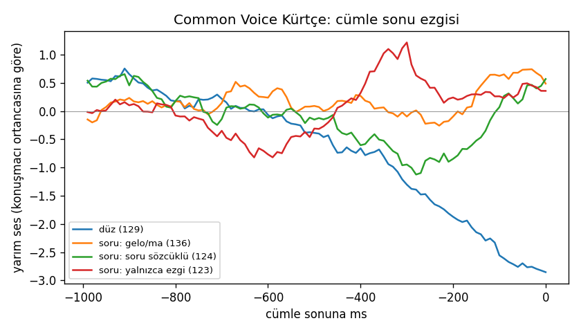

# Kürtçe soru ezgisi: Common Voice'ta ilk ölçüm (14.10.2026)

*Kayıt hattının A adımı: ezgi ölçüm aracı, Botan sohbet kaydı gelmeden önce sınandı. Defter: `kaggle/ezgi-olcum`. Yalnızca ölçüm; hiçbir şey eğitime girmedi.*

**Ne ölçüldü:** Common Voice Kurmancî kayıtlarında, her türden yaklaşık 140 cümlenin son 1 saniyesindeki perde. Bir konuşmacıdan en çok 3 kayıt alındı. Perde, konuşmacının kendi ortanca perdesine göre yarım ses cinsinden ölçüldü. Dört tür:
- düz cümle
- soru sözcüklü soru
- "gelo/ma" ile kurulan soru
- yalnızca ezgiyle sorulan evet/hayır sorusu

| Tür | Sayı | Son 150 ms (ortanca, yarım ses) | Sonu konuşmacı ortancasının üstünde | Sonu belirgin alçak (< −1,5) | Son 0,6 sn'deki tepe (ortanca) |
|---|---|---|---|---|---|
| Düz | 129 | −2,5 | %5 | %72 | +0,9 |
| Soru: yalnızca ezgi | 123 | +0,4 | %52 | %37 | +4,5 |
| Soru: gelo/ma | 136 | +0,3 | %54 | %34 | +4,3 |
| Soru: soru sözcüklü | 124 | 0,0 | %50 | %35 | +3,1 |

## Ne gösteriyor

1. **Düz cümle belirgin şekilde iniyor:** Son saniyede yaklaşık 3 yarım ses alçalıyor.
2. **Soruyu belirleyen şey, sondaki "yükseliş" değil, son hecedeki tepe.** Evet/hayır sorularında perde, cümle bitmeden yaklaşık 0,3 saniye önce zirve yapıyor. Zirve, konuşmacının ortancasından 4–5 yarım ses yukarıda. Sonra biraz iniyor ama düz cümle gibi dibe düşmüyor. Vurgu son hecede olduğu için tepe de büyük olasılıkla son vurgulu hecenin üstünde. Bu bir tahmin; hece hizalaması gelince doğrulanacak.
3. **Soruların üçte biri düz cümle gibi okunmuş.** Ana dili konuşan bir dinleyicinin Common Voice okurları için söylediğini doğruluyor: "konuşmamışlar, okumaya çalışmışlar".

## Bu, ölçme yöntemimizi değiştiriyor

- Deneme 1'de ve bu defterin ilk sürümünde "son 150 ms bir öncekinden yüksek mi?" diye bakılıyordu. Bu ölçü Kürtçe soruyu kaçırıyor; bu ölçüyle sorular "yükselen" %32–37 çıktı.
- Doğru ölçü şu ikisinin birlikte bakılması: son 0,6 saniyede tepe ne kadar yüksek, son ne kadar düşüyor?
- Ezgi hakemi bu iki ölçüyle kurulacak. Deneme 1'deki "soruda yükselen %27" sonucu da bu ölçüyle yeniden hesaplanacak.

## Sınırlar

- Bu kayıtlar sohbet değil, okuma. Okurların ağzı karışık, çoğunun yöresi bilinmiyor. Botan ezgisini Botan sohbet kaydı gösterecek.
- Cümle sonu, konuşma bulucunun (VAD) kestiği yere göre alındı; birkaç onda bir saniyelik kayma olabilir.
- Perde ölçüsü pyin ile yapıldı. Hece ve kelime zamanları henüz yok; kulak eğitilince hizalamayla eklenecek.

## Kayıt karnesi aracı da çalıştı

Dengê Amerîka'dan 8 dosyada sınandı:
- Konuşma payı %85–98.
- Gürültü oranı (SNR) 14–43 dB arasında. Video seslerinin gürültüsü daha yüksek: 14–21 dB.
- Üç dosyada çok az patlama var (binde 1'in altında).

Araç Botan sohbet kaydı için hazır.
